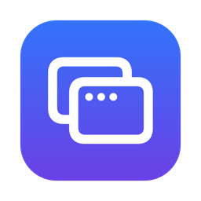

<p align="center">
  
</p>

<h1 align="center">WindowHome</h1>

<p align="center">
  <b>Bring lost windows back to your MacBook's built-in screen, using one shortcut.</b><br>
  A tiny, free, open-source menu bar app for macOS.
</p>

<p align="center">
  <a href="https://github.com/mohamedhadia/WindowHome/releases/latest"></a>
  
  
  <a href="LICENSE"></a>
</p>

---

## The problem

You keep an external monitor plugged into your Mac, but sometimes you switch that monitor to **another computer** (a work PC, a console, a laptop). macOS still thinks the screen is there, so:

- New windows open on a screen you **can't see**.
- The app's menu bar is often on that screen too, so **Window → Move to…** is out of reach.
- Dragging the window back is impossible because you can't see it.

## The fix

WindowHome sits in your menu bar and gives you global keyboard shortcuts that work in **any app**:

| Shortcut | Action |
|---|---|
| <kbd>⌃</kbd> <kbd>⌥</kbd> <kbd>⌘</kbd> <kbd>B</kbd> | Move the **focused window** to the **built-in screen** |
| <kbd>⌃</kbd> <kbd>⌥</kbd> <kbd>⌘</kbd> <kbd>G</kbd> | **Gather all windows** from other screens onto the built-in screen |
| <kbd>⌃</kbd> <kbd>⌥</kbd> <kbd>⌘</kbd> <kbd>N</kbd> | Move the focused window to the **next screen** |

(<kbd>⌃</kbd> Control · <kbd>⌥</kbd> Option · <kbd>⌘</kbd> Command)

Windows keep their relative position and are shrunk to fit if they're larger than the built-in screen. Minimized and full-screen windows are left alone.

## Install

### Option 1: One-line install (easiest)

Paste this into **Terminal**:

```bash
curl -fsSL https://raw.githubusercontent.com/mohamedhadia/WindowHome/main/install.sh | zsh
```

It downloads the latest release, puts it in `/Applications`, and opens it.

### Option 2: Download the DMG

1. Download **`WindowHome.dmg`** from the [latest release](https://github.com/mohamedhadia/WindowHome/releases/latest).
2. Open it and drag **WindowHome** into **Applications**.
3. Open WindowHome from Applications.

> **"WindowHome can't be opened / Apple could not verify…"**
> WindowHome is free and isn't notarized with a paid Apple Developer account, so macOS warns the first time you open it. To allow it:
> - Open **System Settings → Privacy & Security**, scroll down, and click **Open Anyway** next to the WindowHome message, **or**
> - run `xattr -dr com.apple.quarantine /Applications/WindowHome.app` in Terminal.
>
> You only need to do this once. The one-line installer does it for you.

### First launch: grant Accessibility

macOS requires permission for any app that moves other apps' windows.

1. When prompted, open **System Settings → Privacy & Security → Accessibility**.
2. Turn **WindowHome** on.

You can check the status at any time from the menu bar icon. If it says **"Accessibility: Not Allowed — Click to Fix"**, click it.

### Start automatically

Click the menu bar icon and turn on **Launch at Login**.

## Tip: stop new windows opening on the wrong screen

macOS opens new windows on the **main display**, the one with the menu bar. If your external monitor is the main display, apps keep opening there.

Go to **System Settings → Displays → Arrange…** and drag the **white menu-bar strip** onto your built-in display. WindowHome handles anything that still ends up on the other screen.

## Uninstall

1. Quit WindowHome from its menu bar icon.
2. Delete `/Applications/WindowHome.app`.
3. Optionally remove it from **System Settings → Privacy & Security → Accessibility**.

## Privacy

WindowHome works entirely offline. It has no network access, no analytics, and no data collection. It only reads window positions and sizes to move them. The full source is in [`Sources/main.swift`](Sources/main.swift), about 250 lines.

## Build from source

Requirements: macOS 13+ and Xcode Command Line Tools (`xcode-select --install`).

```bash
git clone https://github.com/mohamedhadia/WindowHome.git
cd WindowHome
./scripts/build.sh --install
```

Output:

- `build/WindowHome.app`: universal app (Apple Silicon + Intel)
- `dist/WindowHome.zip` and `dist/WindowHome.dmg`: release packages
- `--install` copies the app to `/Applications` and launches it

To regenerate the app icon: `swift scripts/make-icon.swift`.

> Each local rebuild has a new ad-hoc signature, so macOS may ask for Accessibility again. Remove the old entry and re-enable it.

## Releasing

Releases are built automatically by GitHub Actions ([`.github/workflows/release.yml`](.github/workflows/release.yml)):

```bash
git tag v1.1.0
git push origin v1.1.0
```

The workflow builds the universal app on a macOS runner and publishes `WindowHome.dmg` and `WindowHome.zip` to a new GitHub Release. Every push to `main` also produces a downloadable build artifact.

## How it works

- **Global shortcuts** use the Carbon `RegisterEventHotKey` API, which needs no extra permission.
- **Window moving** uses the macOS Accessibility API (`AXUIElement`) to read and set each window's position and size.
- The **built-in screen** is detected with `CGDisplayIsBuiltin`, so it works no matter how your displays are arranged.

## License

[MIT](LICENSE)
